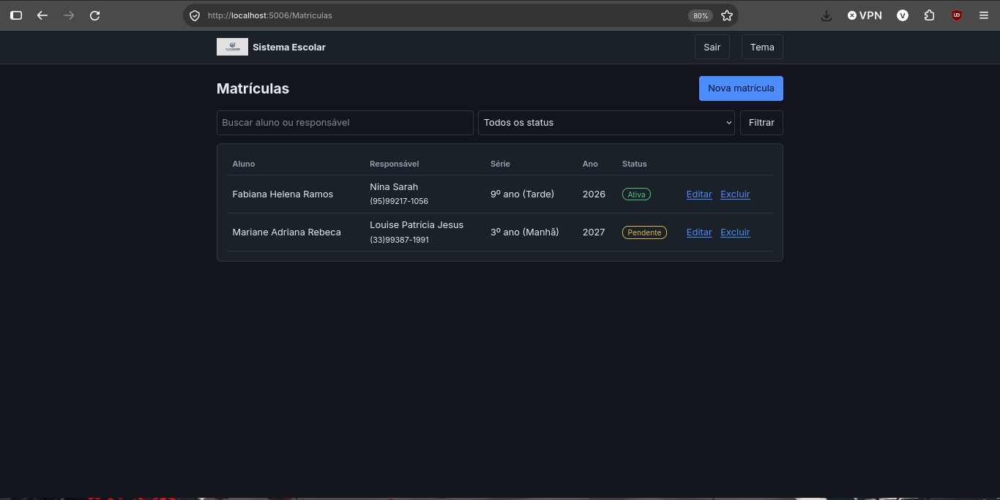
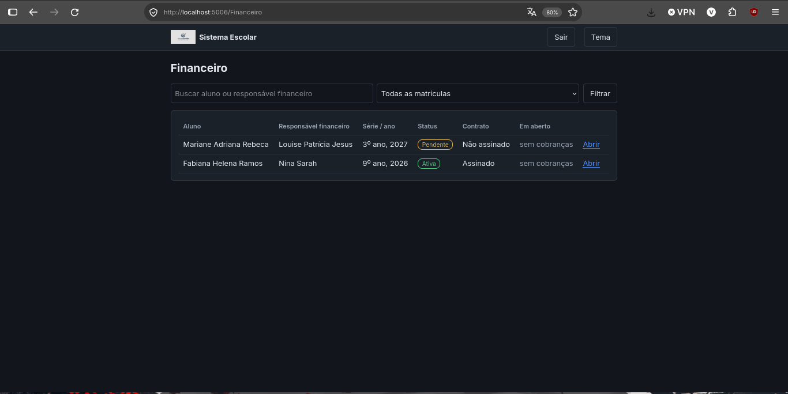
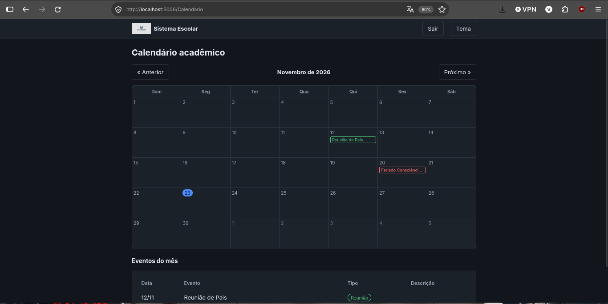

# 🎓 Sistema Escolar

Sistema web de gestão escolar: **matrícula, turmas, notas, frequência, calendário e financeiro**, com quatro perfis de acesso (responsável, funcionário, professor e aluno), cada um vendo só o que lhe cabe.

Feito para ser **leve**: HTML renderizado no servidor, quase nenhum JavaScript (sem frameworks) e CSS enxuto, para rodar bem até em computadores antigos. Tem modo escuro desde o início.


## 🖼️ Telas

| Matrículas | Financeiro |
|---|---|
|  |  |



## ✨ O que o sistema faz

| Módulo | O que faz | Quem usa |
|---|---|---|
| **Matrícula** | Cria o aluno junto com a matrícula (não existe aluno sem matrícula), rematrícula pelo CPF, status Pendente / Ativa / Cancelada / Transferida | Funcionário |
| **Alunos** | Consulta, correção de dados e criação de acessos (aluno e responsável) | Funcionário |
| **Professores** | Cadastro, login com senha provisória, inativação | Funcionário |
| **Disciplinas** | Catálogo por série, com disciplinas padrão | Funcionário |
| **Turmas** | Série + ano + letra, enturmação de alunos ativos e professor por disciplina | Funcionário |
| **Notas e frequência** | Notas por bimestre, recuperação, aulas dadas e faltas | Professor |
| **Desempenho** | Consulta de notas, frequência e situação por turma e por aluno (só leitura) | Funcionário |
| **Boletim** | Notas, recuperação, frequência e situação (aprovado, recuperação, reprovado) | Aluno e responsável |
| **Calendário** | Grade mensal com feriados, recessos, provas e reuniões | Todos veem, funcionário cadastra |
| **Financeiro** | Contrato, taxa e mensalidades, multa e juros, baixa de pagamentos, recibo para imprimir e relatório de inadimplência; libera a matrícula pendente | Funcionário (responsável consulta) |
| **Sala de aula** | Professor publica avisos, materiais e atividades com prazo por turma e disciplina; aluno e responsável leem | Professor (publica), aluno e responsável |
| **Configurações** | Médias de aprovação e recuperação, modelo da média final, frequência mínima, multa e juros | Funcionário |

### Algumas regras de negócio
- A matrícula nasce **Pendente** e vira **Ativa** sozinha quando o contrato está assinado e a taxa de matrícula paga (ou manualmente pelo funcionário).
- Só alunos com matrícula **Ativa**, da mesma série, ano e turno, entram na turma.
- A **média de aprovação, a de recuperação e a frequência mínima** são configuráveis. Há 3 modelos para a média final com recuperação (média das duas, maior das duas, substitui a média).
- **Multa** (única) e **juros** (simples, proporcionais aos dias) calculados na hora para cobranças em atraso; o valor recebido fica gravado.
- Segurança: senhas com PBKDF2, **senha provisória obrigatória de trocar** no primeiro acesso, **limite de tentativas de login**, autorização por perfil em cada página.

## 🧱 Tecnologias

- C# / ASP.NET Core (.NET 10), Razor Pages
- Entity Framework Core + PostgreSQL (Npgsql 10.x)
- Autenticação por cookie
- Tema claro/escuro por variáveis CSS; sem Bootstrap, jQuery ou frameworks de JS
- Validação feita no servidor; máscaras de CPF, telefone e data em um único `site.js`

## 🚀 Como rodar

Requisitos: [.NET 10 SDK](https://dotnet.microsoft.com/download) e um PostgreSQL. Se não tiver um, o `docker-compose.yml` sobe um:

```bash
docker compose up -d
```

Guarde a conexão (fora do repositório, via user-secrets) e rode:

```bash
dotnet user-secrets set "ConnectionStrings:Escola" "Host=localhost;Port=5432;Database=escola;Username=escola;Password=escola_dev"
dotnet run
```

Abra <http://localhost:5006>. O banco é criado (e atualizado) sozinho pelas migrations na primeira execução.

Em **Development** são criados 4 usuários de teste, todos com a senha `Escola@123`:
`funcionario@escola.test`, `professor@escola.test`, `aluno@escola.test` e `responsavel@escola.test`.
Em produção eles não existem: defina a conexão pela variável `ConnectionStrings__Escola` e crie os usuários reais por outro meio.

### Dados de demonstração

Para ver o sistema cheio (30 alunos, turmas, notas, cobranças em dia e atrasadas), só em Development:

```bash
dotnet run -- --demo          # cria os dados fictícios
dotnet run -- --demo-limpar   # remove só o que ele criou
```

## ✅ Testes

```bash
dotnet test tests/SistemaEscolar.Tests
```

São 94 testes automatizados das regras de negócio (validação de CPF e telefone, média, recuperação e situação do aluno, frequência, multa e juros, liberação da matrícula, limite de tentativas de login). Outros 3 testes de integração aplicam as migrations num PostgreSQL real, em um banco temporário que o próprio teste cria e apaga:

```bash
ESCOLA_TEST_DB="Host=localhost;Port=5432;Database=postgres;Username=escola;Password=escola_dev" dotnet test tests/SistemaEscolar.Tests
```

## 📁 Estrutura

```
Data/            Entidades, regras (aprovação, financeiro, validações) e o contexto do EF
Migrations/      Migrations do EF Core (esquema do banco)
tests/           Testes automatizados (xUnit)
Pages/           Telas por módulo (Matriculas, Alunos, Professores, Disciplinas, Turmas, Notas,
                 Desempenho, Boletim, SalaDeAula, Calendario, Financeiro, Mensalidades, Conta, Configuracoes)
Pages/Shared/    Layout e partials compartilhados
wwwroot/         site.css e site.js
```

## 🤖 Como foi feito

Este projeto foi desenvolvido em parceria com o **Claude Code** (IA da Anthropic), em passos pequenos: um módulo por vez, cada um testado no navegador contra um PostgreSQL real, com os dados de teste removidos ao final. As regras de negócio foram decididas por mim (por exemplo: aluno só existe junto com a matrícula; liberação da matrícula pelo contrato e pagamento) e a IA implementou, testou e corrigiu. O arquivo [`CLAUDE.md`](CLAUDE.md) é o contexto que mantém o trabalho consistente entre sessões.

## ⚠️ Limitações conhecidas

- A Sala de aula é um mural simples: sem anexos, sem entrega de atividade pelo aluno e sem edição de publicações.
- Não há envio de e-mail: "esqueci minha senha" depende do funcionário gerar uma senha provisória; a baixa de pagamentos é manual (sem boleto ou Pix real).

## 🗺️ Próximos passos

Entrega de atividades, anexos, recibo no acesso do responsável e testes de interface (páginas).

## 📄 Licença

[MIT](LICENSE)
